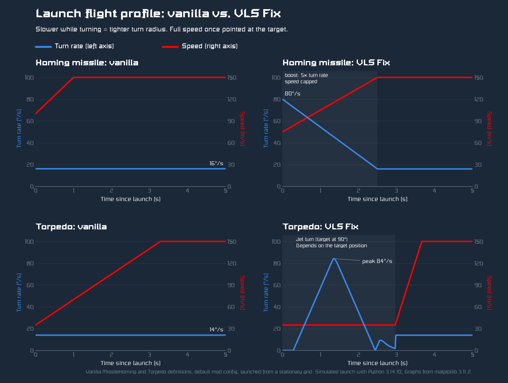

# VLS Fix

A tiny Space Engineers mod that fixes vertically launched torpedoes. Each torpedo gets a delay of 0.3 to 6.3 seconds to align itself to the target before Homing Guidance engages.

It also boosts the Homing Missile's turn rate in inverse proportion to its speed, up to 5x, during the speed ramp in the first 2.5 seconds of flight. Once the missile reaches maximum speed, it behaves like vanilla.

**[Steam Workshop](https://steamcommunity.com/sharedfiles/filedetails/?id=3842655832)** · [Check out my other mods](https://steamcommunity.com/sharedfiles/filedetails/?id=3831924836)

---

---

## Configuration

The config is read once at world load, on the server only. The server then sends it to all clients, so every machine flies the same path. Layers are applied in this order:

1. This mod's [`Data/VLS.xml`](VLS_Fix/Content/Data/VLS.xml) (defaults).
2. The `Data/VLS.xml` of any other loaded mod, in load order. Its subtypes are added to the lists and its values override the defaults. Mod authors can use this to register their own torpedoes.
3. A per-world `VLS.xml` in the world's Storage folder (`Saves/<world>/Storage/<mod>_VLS_Fix.../VLS.xml`). It overrides everything above.

See [`VLS.example.xml`](VLS_Fix/Content/Data/VLS.example.xml) for every option, with comments.

## Building

This is an [MDK2](https://github.com/malforge/mdk2) mod project. Open `VLS_Fix.sln` in Rider or Visual Studio and build. MDK deploys it to your local Space Engineers mods folder.

## License

Public domain ([Unlicense](LICENSE)).
